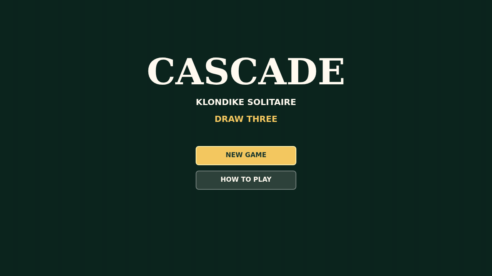
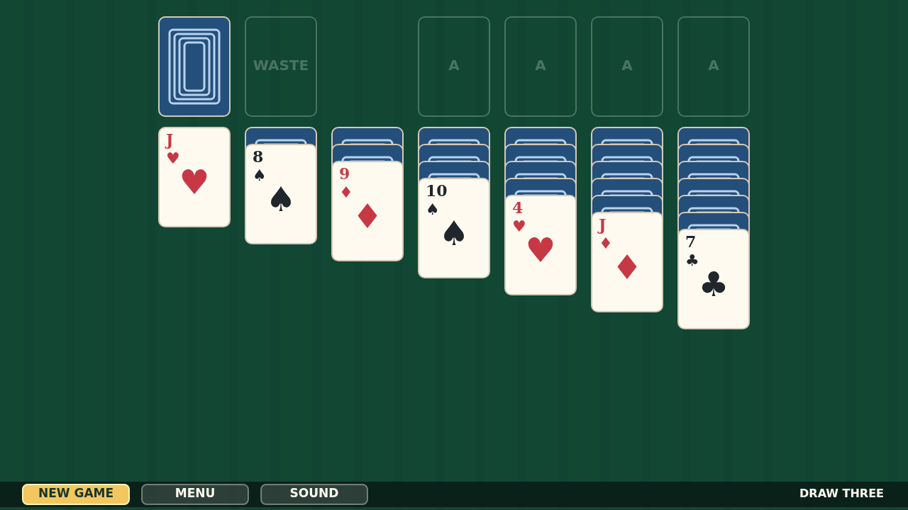

# Cascade

Cascade is a calm Draw Three Klondike solitaire played on a deep felt table.
Turn the stock in fanned sets of three, move alternating-color runs down the
tableau, and build each foundation from ACE through KING.

The table is made for direct play: drag cards or stacks with a mouse or touch,
click the STOCK to turn or recycle, and DOUBLE-CLICK exposed cards to send them
home when a foundation is ready.

When the last card lands, the quiet table breaks into motion. The foundations
launch card after card into a bouncing victory cascade, painting the felt with
overlapping cards until the whole game is buried in the win.

